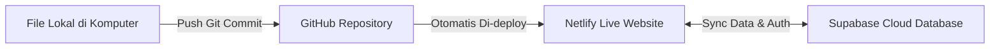

# 🏗️ CONSTRACK 2.2 – Construction Project Monitoring & Management System

> **Aplikasi Simulasi & Monitoring Manajemen Proyek Konstruksi Berbasis Web untuk Mahasiswa Teknik Sipil**  
> Didesain dengan antarmuka elegan bertema **Hijau Sage (Sage Green)** yang nyaman di mata, ramah pemula, memiliki perhitungan otomatis standar SNI/AHSP, mendukung **multi-user** dan **kerja kelompok**, data awal **100% KOSONG** untuk latihan mandiri, dilengkapi **modul contoh pengisian terpisah**, serta siap dipublikasikan secara online melalui **GitHub, Netlify, dan Supabase**.

---

## 📋 Daftar Isi
1. [Tentang CONSTRACK 2.2](#-tentang-constrack-22)
2. [Pembaruan Versi 2.2 (Template Kosong & Contoh Terpisah)](#-pembaruan-versi-22)
3. [Identitas Visual – Tema Hijau Sage](#-identitas-visual--tema-hijau-sage)
4. [Fitur Unggulan Sistem](#-fitur-unggulan-sistem)
5. [Struktur Berkas Proyek](#-struktur-berkas-proyek)
6. [Panduan Menjalankan Aplikasi Secara Lokal (Offline)](#-panduan-menjalankan-aplikasi-secara-lokal-offline)
7. [Panduan Langkah-demi-Langkah Publikasi Online (Netlify + GitHub + Supabase)](#-panduan-langkah-demi-langkah-publikasi-online)
   - [Langkah 1: Setup Repository GitHub & Push Pembaruan](#langkah-1-setup-repository-github--push-pembaruan)
   - [Langkah 2: Setup Database Cloud Supabase](#langkah-2-setup-database-cloud-supabase)
   - [Langkah 3: Deploy Website ke Netlify](#langkah-3-deploy-website-ke-netlify)
   - [Jaminan Persistensi Data Pengguna](#-keamanan--persistensi-data)
8. [Panduan Akun Multi-User & Kolaborasi Kelompok](#-panduan-akun-multi-user--kolaborasi-kelompok)
9. [Panduan Contoh Pengisian Tiap Modul (Edukasi Mahasiswa)](#-panduan-contoh-pengisian-tiap-modul)
10. [Rumus Perhitungan Manajemen Konstruksi (EVM, RAB, Jadwal)](#-rumus-perhitungan-manajemen-konstruksi)

---

## 🌟 Tentang CONSTRACK 2.2

**CONSTRACK** adalah sistem informasi manajemen dan pemantauan proyek konstruksi (*Construction Project Monitoring & Management System*) yang dirancang khusus untuk memenuhi kebutuhan akademik mahasiswa Teknik Sipil, dosen pembimbing, serta praktisi konstruksi muda.

Aplikasi ini mengintegrasikan seluruh pilar utama manajemen proyek:
* **Scope & RAB**: Pengelompokan *Work Breakdown Structure* (WBS) & Analisa Harga Satuan Pekerjaan (AHSP).
* **Schedule & Time Control**: Penjadwalan minggu ke minggu dan Gantt Chart interaktif.
* **Progress Tracking & Kurva S**: Kurva S akumulatif rencana vs. realisasi lapangan.
* **Cost & Cash Flow**: Pengendalian anggaran, Buku Kas Keluar (BKK), termin pembayaran, dan pemantauan defisit kas.
* **Earned Value Management (EVM)**: Evaluasi kinerja proyek berbasis metode nilai hasil (PV, EV, AC, SPI, CPI, EAC, ETC, VAC) dengan penanganan pembagian nol (*zero-division guard*).
* **Edukasi Interaktif**: Kamus istilah konstruksi, panduan modul bertahap, dan skenario studi kasus 1-klik.

---

## ⚡ Pembaruan Versi 2.2

Menindaklanjuti kebutuhan evaluasi pembelajaran mahasiswa dan penyempurnaan deployment Netlify:

1. **Data Awal 100% KOSONG (*True Empty State*)**:
   - Akun mahasiswa baru tidak lagi diisi otomatis dengan data dummy.
   - Saat membuat proyek baru, seluruh kolom formulir (nama, lokasi, jenis, tanggal, anggaran) dalam keadaan **kosong**.
   - Tabel RAB, jadwal, pengeluaran riil, dan arus kas dimulai dari **0 data**.
   - Setiap halaman menampilkan kartu *Empty State* yang rapi dengan tombol aksi langsung.
2. **Modul Contoh Pengisian Terpisah (*Separated Educational Examples*)**:
   - Disediakan tombol **"Contoh Pengisian"** di bilah atas navbar, tombol di header tiap halaman, serta tombol panduan di dalam modal input.
   - Membuka modal panduan referensi contoh pengisian lengkap (Identitas, RAB, Jadwal, Progres, Kurva S, Arus Kas, EVM) yang **tidak akan mengubah atau mencampuri data proyek aktif pengguna**.
3. **Penyempurnaan Tombol & Interaktivitas Netlify**:
   - Seluruh fungsi JavaScript dipasangkan langsung ke `window` global scope untuk mencegah error `ReferenceError` pada browser.
   - Konfigurasi `netlify.toml` diperbarui dengan header `no-cache, must-revalidate` agar browser pengunjung selalu memuat versi kode terbaru.
   - Penambahan parameter versi berkas (`?v=2.2.0`) pada script HTML.
4. **Indikator Status Penyimpanan Jujur & Transparan**:
   - Jika Supabase belum dikonfigurasi, header menampilkan badge: `Penyimpanan Lokal Aktif (Cloud Belum Terhubung)`.
   - Data otomatis tersimpan di LocalStorage terisolasi per akun mahasiswa.

---

## 🌿 Identitas Visual – Tema Hijau Sage

Antarmuka CONSTRACK 2.2 dirancang dengan palet warna **Hijau Sage (Sage Green)** yang lembut, bersih, minimalis, dan ergonomis bagi mata mahasiswa:

| Peran Warna | Hex Code | Tampilan / Penggunaan |
| :--- | :--- | :--- |
| **Sage Utama** | `#A3BFA8` | Identitas brand, aksen tombol aktif, header tabel, indikator status aman |
| **Sage Muda** | `#DCE8DC` | Background badge, kartu sekunder, hover menu sidebar, isian progress bar |
| **Background Utama** | `#F3F6F0` | Latar belakang seluruh halaman aplikasi (anti-silau dan nyaman di mata) |
| **Hijau Gelap Kontras** | `#536B57` | Warna teks judul, ikon aktif, tombol aksi primer, garis grafik realisasi |
| **Putih Bersih** | `#FFFFFF` | Latar kartu dashboard, panel modal formulir, dan tabel data |

---

## 📁 Struktur Berkas Proyek

```
WEB/
├── index.html            # Antarmuka SPA tema Hijau Sage, modal input kosong & modal contoh pengisian
├── style.css             # Desain UI: palet Sage Green, layout responsif, empty states, print stylesheet
├── netlify.toml          # Konfigurasi Netlify (no-cache headers, SPA redirects, security headers)
├── supabase_schema.sql   # Skrip DDL PostgreSQL untuk database Supabase lengkap dengan RLS
├── README.md             # Panduan master lengkap, dokumentasi teknis, dan tutorial deploy
└── js/
    ├── supabase.js       # Client wrapper Supabase v2, enkripsi SHA-256, dan engine dual-storage
    ├── data.js           # Kamus glosarium sipil, template 6 jenis konstruksi, & EXAMPLE_GUIDES terpisah
    └── app.js            # Controller logika aplikasi, engine rumus EVM/RAB, Chart.js, & render halaman
```

---

## 💻 Panduan Menjalankan Aplikasi Secara Lokal (Offline)

Aplikasi ini dibangun menggunakan teknologi web murni (**Vanilla JavaScript, HTML5, CSS3**) tanpa memerlukan instalasi build tool:

1. Unduh atau salin seluruh folder `WEB/` ke komputer Anda.
2. Klik ganda file [`index.html`](index.html) atau klik kanan lalu pilih **Buka dengan (Open with) -> Browser**.
3. Website akan langsung terbuka dan siap digunakan secara offline.
4. Anda dapat login menggunakan akun demo atau membuat akun baru via tab **Daftar Akun Baru**.

---

## 🌐 Panduan Langkah-demi-Langkah Publikasi Online

Jika website Anda sudah terhubung ke Netlify (misalnya di `https://constrack-build.netlify.app/`), ikuti langkah di bawah ini untuk memperbarui kodenya:



---

### Langkah 1: Setup Repository GitHub & Push Pembaruan

Buka terminal (PowerShell / Command Prompt / Git Bash) di folder proyek:

```bash
# 1. Masuk ke folder proyek
cd c:\Users\user\OneDrive\Desktop\WEB

# 2. Periksa status perubahan
git status

# 3. Tambahkan semua file yang telah diperbaiki
git add .

# 4. Buat commit pembaruan
git commit -m "fix: perbaikan seluruh tombol, data kosong awal, modal contoh pengisian v2.2"

# 5. Push ke branch main di GitHub
git push origin main
```

Netlify akan mendeteksi commit baru ini dan secara otomatis mempublikasikan pembaruan ke alamat `https://constrack-build.netlify.app/` dalam waktu 15–30 detik!

---

### Langkah 2: Setup Database Cloud Supabase (Opsional)

Jika ingin mengaktifkan database PostgreSQL di cloud:
1. Buka [supabase.com](https://supabase.com) dan buat project baru.
2. Buka menu **SQL Editor**, salin seluruh kode dari file [`supabase_schema.sql`](supabase_schema.sql), lalu klik **Run**.
3. Buka menu **Project Settings -> API**, salin **Project URL** dan **Anon public key**.
4. Buka website CONSTRACK, klik badge **Penyimpanan Lokal** di header navbar, masukkan URL & Anon Key, lalu simpan. Status akan berubah menjadi **Cloud Supabase Terhubung**.

---

### 🛡️ Keamanan & Persistensi Data

* **Pemisahan Kode dan Data**: Server Netlify hanya menyajikan file statis (HTML/CSS/JS). Data proyek pengguna disimpan terpisah di Supabase Cloud atau LocalStorage browser.
* **Redeploy Aman**: Setiap kali Anda melakukan update kode (`git push`), data proyek dan akun pengguna yang sudah tersimpan **tidak akan terhapus atau ter-reset**.

---

## 📖 Panduan Contoh Pengisian Tiap Modul

Formulir utama disiapkan **kosong**, namun mahasiswa dapat membuka modul panduan kapan saja:

### 1. Identitas Proyek
* **Nama**: `Pembangunan Gedung Laboratorium dan Ruang Kuliah 3 Lantai`
* **Jenis**: `Bangunan Gedung`
* **Lokasi**: `Jl. Kaliurang KM 9, Sleman, D.I. Yogyakarta`
* **Waktu**: `5 Januari 2026 s/d 30 Juni 2026 (176 Hari / 26 Minggu)`
* **Nilai Kontrak / RAB**: `Rp 2.500.000.000 / Rp 2.400.000.000`

### 2. Rencana Anggaran Biaya (RAB)
$$\text{Jumlah Harga} = \text{Volume} \times \text{Harga Satuan (AHSP)}$$
$$\text{Bobot Pekerjaan (\%)} = \left(\frac{\text{Jumlah Harga Item}}{\text{Total Nilai RAB}}\right) \times 100\%$$

| Uraian Pekerjaan | Volume | Satuan | Harga Satuan | Jumlah Harga | Bobot (%) |
| :--- | :---: | :---: | :---: | :---: | :---: |
| Galian tanah pondasi sedalam 1-2 m | 100.00 | m³ | Rp 100.000 | Rp 10.000.000 | 16.67% |
| Pasangan dinding bata merah 1/2 bata | 200.00 | m² | Rp 150.000 | Rp 30.000.000 | 50.00% |
| Pengecoran beton mutu K-250 | 20.00 | m³ | Rp 1.000.000 | Rp 20.000.000 | 33.33% |

### 3. Jadwal & Durasi Pekerjaan
$$\text{Durasi Hari} = \frac{\text{Volume Pekerjaan}}{\text{Produktivitas Harian} \times \text{Jumlah Regu Kerja}}$$
* Pekerjaan Persiapan: `5 Jan 2026 - 10 Jan 2026 (6 Hari)`
* Pekerjaan Tanah: `11 Jan 2026 - 25 Jan 2026 (15 Hari)`
* Pekerjaan Pondasi: `26 Jan 2026 - 15 Feb 2026 (21 Hari)`

### 4. Progres Fisik & Kurva S
* Target Rencana Kumulatif (M-10): `40.00%`
* Capaian Aktual Kumulatif (M-10): `35.00%`
* Deviasi Fisik: `35% - 40% = -5.00% (Keterlambatan)`
* *Arti:* Progres fisik riil di lapangan tertinggal 5% terhadap target baseline jadwal rencana.

### 5. Arus Kas (Cash Flow)
$$\text{Net Cash Flow} = \text{Pemasukan Termin} - \text{Pengeluaran Operasional (BKK)}$$
* Pemasukan: Pembayaran Termin Pertama `Rp 100.000.000`
* Pengeluaran: Pembelian Semen, Pasir, dan Besi Beton `Rp 25.000.000`
* Net Cash Flow: `+Rp 75.000.000`

### 6. Earned Value Management (EVM)
* **BAC**: `Rp 100.000.000`
* **Planned Value (PV)**: $40\% \times \text{BAC} = \text{Rp } 40.000.000$
* **Earned Value (EV)**: $35\% \times \text{BAC} = \text{Rp } 35.000.000$
* **Actual Cost (AC)**: $\text{Rp } 32.000.000$
* **Schedule Variance (SV)**: $\text{EV} - \text{PV} = -\text{Rp } 5.000.000$ (Terlambat)
* **Cost Variance (CV)**: $\text{EV} - \text{AC} = +\text{Rp } 3.000.000$ (Hemat)
* **SPI**: $35 / 40 = 0.875$ (Keterlambatan waktu, $\text{SPI} < 1.0$)
* **CPI**: $35 / 32 = 1.094$ (Penghematan biaya, $\text{CPI} > 1.0$)
* **EAC**: $\text{BAC} / \text{CPI} = \text{Rp } 91.407.678$ (Estimasi biaya akhir)
* **VAC**: $\text{BAC} - \text{EAC} = +\text{Rp } 8.592.322$ (Potensi sisa laba)

---

## 🎓 Kontak & Lisensi

Platform ini dikembangkan sebagai media pembelajaran terbuka (*open educational resource*) untuk memajukan pendidikan teknik sipil dan manajemen rekayasa konstruksi di Indonesia.

* **Lisensi**: MIT License
* **Akses Publik**: [https://constrack-build.netlify.app/](https://constrack-build.netlify.app/)
